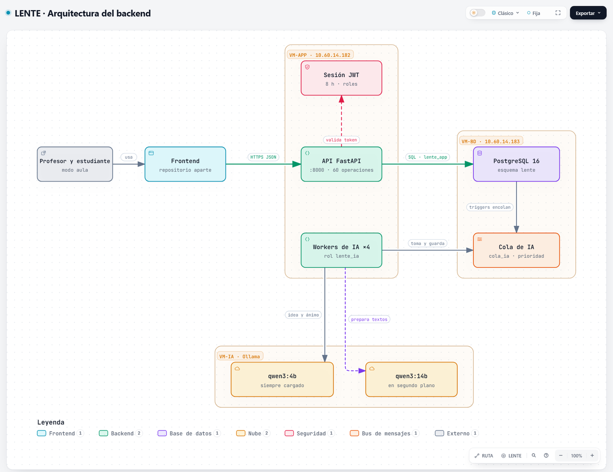
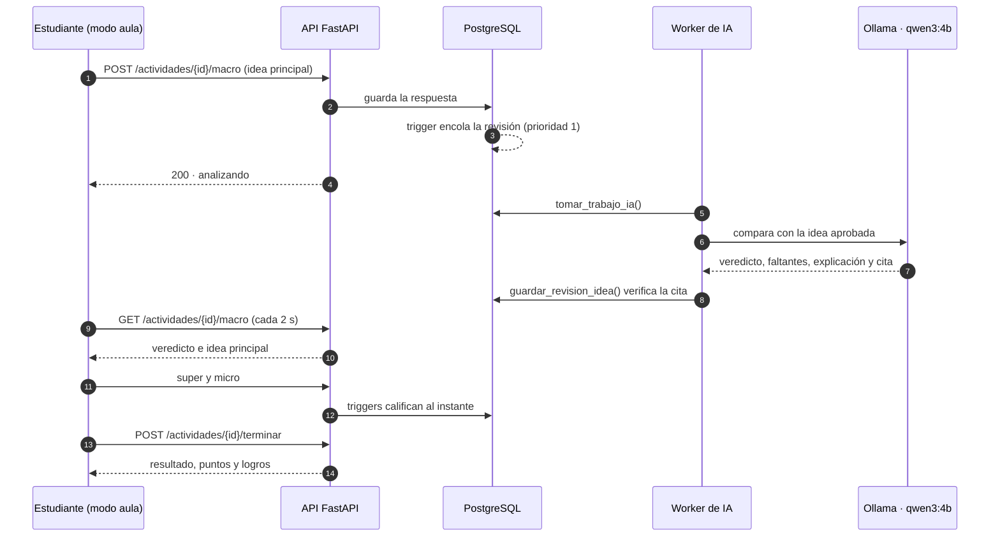

<div align="center">

# 🔎 LENTE · Backend

**Alfabetización mediática con inteligencia artificial, basada en el análisis crítico del discurso de Teun van Dijk**

API en FastAPI, lógica de negocio en PostgreSQL y modelos de lenguaje locales con Ollama, para que estudiantes de colegio aprendan a leer noticias de forma crítica.

[](https://github.com/mvega09/lente/actions/workflows/pruebas.yml)


[Arquitectura](#-arquitectura) ·
[Cómo funciona](#-cómo-funciona-una-actividad) ·
[Puesta en marcha](#-puesta-en-marcha) ·
[Despliegue](#-despliegue) ·
[Pruebas](#-pruebas) ·
[Documentación](#-documentación)

</div>

---

## ✨ Qué es LENTE

LENTE guía al estudiante por los tres niveles con los que Van Dijk propone analizar un texto:

| Nivel | Pregunta que se hace el estudiante | Cómo lo evalúa LENTE |
|---|---|---|
| **Macroestructura** | ¿Cuál es la idea principal? | Una IA local compara su respuesta con la idea aprobada por el profesor y le explica qué le faltó, citando la noticia |
| **Superestructura** | ¿Cómo está organizado el texto? | Preguntas de selección múltiple calificadas al instante por la base de datos |
| **Microestructura** | ¿Qué palabras muestran una postura? | El estudiante marca palabras cargadas y la base las compara con las aprobadas |

El profesor sube una noticia, la IA propone el análisis completo y **el profesor lo revisa y aprueba** antes de usarlo en clase. Así, la IA asiste pero el docente siempre tiene la última palabra.

## 🏗 Arquitectura

<p align="center">
  <picture>
    <source media="(prefers-color-scheme: dark)" srcset="docs/arquitectura/lente-arquitectura-oscuro.png" />
    
  </picture>
</p>

<p align="center"><sub>Diagrama generado con <a href="https://github.com/tt-a1i/archify">archify</a>. La <a href="docs/arquitectura/lente-arquitectura.html">versión interactiva</a> (descárgala y ábrela en el navegador) permite buscar, seguir rutas y abrir el código que respalda cada componente.</sub></p>

| Máquina | Dirección | Qué corre |
|---|---|---|
| **VM-APP** | `10.60.14.182` | API FastAPI (`lente-api`, puerto 8000) y 4 workers de IA (`lente-worker@1..4`) |
| **VM-BD** | `10.60.14.183` | PostgreSQL 16 con el esquema `lente`: tablas, triggers, funciones, vistas y la cola de IA |
| **VM-IA** | `10.60.14.181` | Ollama con `qwen3:4b` (siempre cargado) y `qwen3:14b`, 4 solicitudes en paralelo, sin GPU |

**Decisiones de diseño**

- **La lógica vive en PostgreSQL.** Calificación, puntos, rachas, logros, alertas y la cola de IA son triggers y funciones. La API es delgada: valida, llama funciones y devuelve JSON.
- **La IA nunca bloquea una petición.** La API encola el trabajo y responde al instante; los workers lo procesan y el frontend consulta el resultado. La cola usa `FOR UPDATE SKIP LOCKED` y prioriza al estudiante que está esperando.
- **Dos roles de base de datos.** La API usa `lente_app`; los workers usan `lente_ia`, que no puede leer nombres de estudiantes ni de profesores.
- **Configurable sin tocar código.** Modelos, instrucciones de la IA, puntos y umbrales se leen de la tabla `ajustes`.

## 🧭 Cómo funciona una actividad



## 🧰 Stack

| Capa | Tecnología |
|---|---|
| API | Python 3.12 · FastAPI · Pydantic · Uvicorn |
| Base de datos | PostgreSQL 16 · psycopg 3 (pool asíncrono) · pgcrypto |
| IA | Ollama · qwen3:4b (validación) · qwen3:14b (preparación) · salida estructurada con JSON Schema |
| Sesiones | JWT (HS256, 8 h) · contraseñas con bcrypt en la base |
| Calidad | pytest · pglast (analizador real de PostgreSQL) · GitHub Actions |
| Documentación | MkDocs Material · OpenAPI / Swagger · archify |
| Despliegue | systemd en Ubuntu 24.04 |

## 📁 Estructura

```text
lente/
├── app/                    API FastAPI
│   ├── main.py             crea la aplicación y registra los routers
│   ├── core/               configuración, pool de base, JWT, errores
│   ├── routers/            sesión, admin, cursos, textos, actividades, seguimiento
│   ├── schemas/            modelos Pydantic de entrada y salida
│   └── services/           SQL en constantes SQL_* y reglas por módulo
├── worker/                 worker de IA: cola → Ollama → base
├── db/schema.sql           esquema completo (tablas, triggers, funciones, vistas, roles)
├── scripts/                mediciones, validación docente, cuentas y pruebas reales
├── tests/                  pruebas unitarias y de integración
├── deploy/                 servicios systemd y base de pruebas
└── docs/                   documentación MkDocs y diagrama de arquitectura
```

## 🚀 Puesta en marcha

**Requisitos:** Python 3.12, acceso a un PostgreSQL con `db/schema.sql` aplicado y a un servidor Ollama.

```bash
git clone https://github.com/mvega09/lente.git && cd lente
python3 -m venv .venv && source .venv/bin/activate
pip install -r requirements.txt
cp .env.example .env            # complete las claves (nunca se sube a GitHub)
python -m scripts.verificar_conexion   # comprueba base e IA, solo lectura
uvicorn app.main:app --reload --host 0.0.0.0 --port 8000
python -m worker.ia_worker      # en otra terminal
```

La documentación interactiva queda en `http://localhost:8000/docs`.

<details>
<summary><b>Variables de entorno principales</b></summary>

| Variable | Para qué | Ejemplo |
|---|---|---|
| `DB_HOST`, `DB_NAME` | Servidor y base | `10.60.14.183`, `lente` |
| `DB_APP_USER` / `DB_APP_PASSWORD` | Rol de la API | `lente_app` |
| `DB_IA_USER` / `DB_IA_PASSWORD` | Rol de los workers | `lente_ia` |
| `JWT_SECRETO` | Firma de los tokens | `python3 -c "import secrets; print(secrets.token_urlsafe(48))"` |
| `CORS_ORIGENES` | Orígenes del frontend | `["http://localhost:3000"]` |
| `OLLAMA_URL` | Servidor de IA | `http://10.60.14.181:11434` |
| `OLLAMA_MODELO_VALIDACION` | Modelo que revisa la idea principal | `qwen3:4b` |
| `OLLAMA_MODELO_PREPARACION` | Modelo que prepara los textos | `qwen3:14b` |

La lista completa está en [`.env.example`](.env.example).
</details>

## 🖥 Despliegue

En la VM-APP, la API y los workers corren como servicios de systemd y arrancan solos con la máquina:

```bash
sudo cp deploy/lente-api.service "deploy/lente-worker@.service" /etc/systemd/system/
sudo systemctl daemon-reload
sudo systemctl enable --now lente-api lente-worker@1 lente-worker@2 lente-worker@3 lente-worker@4
```

| Tarea | Comando |
|---|---|
| Ver el estado | `systemctl is-active lente-api "lente-worker@*"` |
| Ver el registro en vivo | `journalctl -u lente-api -u "lente-worker@*" -f` |
| Aplicar cambios de código o del `.env` | `sudo systemctl restart lente-api "lente-worker@*"` |

Se usa una copia del worker por cada espacio en paralelo de Ollama (`OLLAMA_NUM_PARALLEL=4`).

## 🧪 Pruebas

| Tipo | Qué cubre | Cómo correrlas |
|---|---|---|
| **Unitarias** (283) | Reglas de cada módulo, sesión, worker, y la sintaxis de todo el SQL contra el analizador real de PostgreSQL, columna por columna contra `db/schema.sql` | `pytest` (sin base ni IA) |
| **Integración** | Flujo completo y aislamiento entre profesores contra una base de pruebas | `LENTE_PRUEBAS_INTEGRACION=1 pytest -m integracion` |
| **Punta a punta** | API, base e IA reales: profesor, curso, texto preparado por la IA, actividad completa y panel | `python -m scripts.prueba_flujo_real` |
| **Continua** | Pruebas unitarias y documentación en cada push | GitHub Actions |

## 🤖 Rendimiento de la IA

Medido en la VM-IA (8 vCPU, sin GPU). Detalle en [`docs/benchmark-ia.md`](docs/benchmark-ia.md).

| Tarea | Modelo | Tiempo |
|---|---|---|
| Revisar la idea principal (1 estudiante) | qwen3:4b | 12–14 s; 22 s el primero de cada texto nuevo |
| 20 estudiantes enviando al mismo tiempo | qwen3:4b, 4 en paralelo | ≈ 10 por minuto; el último espera ≈ 2 min |
| Preparar un texto (en segundo plano) | qwen3:14b | ≈ 5 min |

Cumplir 15 s con muchos estudiantes simultáneos requiere GPU; la hoja de ruta lo detalla.

## 🔐 Seguridad y privacidad

- Sesiones con JWT de 8 horas y roles `administrador` y `profesor`; el estudiante no tiene cuenta.
- Cada profesor solo ve lo suyo: un recurso de otro profesor responde **404**.
- Bloqueo tras 5 intentos fallidos y cambio de clave obligatorio en cuentas nuevas.
- A la IA solo llegan el texto y la respuesta; los prompts completos no se guardan.
- Las respuestas llevan un código de envío: reenviarlas por mala conexión no las duplica.
- Ningún secreto vive en el repositorio: claves y tokens van en `.env`.

## 📚 Documentación

| Recurso | Dónde |
|---|---|
| Endpoints interactivos | `http://10.60.14.182:8000/docs` |
| Todos los endpoints en texto | [`docs/api.md`](docs/api.md) |
| Arquitectura | [`docs/arquitectura.md`](docs/arquitectura.md) |
| Contexto para el frontend y asistentes de IA | [`docs/frontend/CLAUDE.md`](docs/frontend/CLAUDE.md) |
| Instalación detallada | [`docs/instalacion.md`](docs/instalacion.md) |
| Worker de IA | [`docs/worker.md`](docs/worker.md) |
| Hoja de ruta y decisiones | [`docs/hoja-de-ruta.md`](docs/hoja-de-ruta.md) |

Sitio de documentación local: `mkdocs serve -a 0.0.0.0:8001`.

## 🎓 Créditos

Proyecto de grado del semillero de investigación de la **Universidad de Manizales**. Este repositorio contiene el backend; el frontend se desarrolla en un repositorio aparte.

El repositorio no tiene licencia de código abierto: todos los derechos quedan reservados a sus autores.
