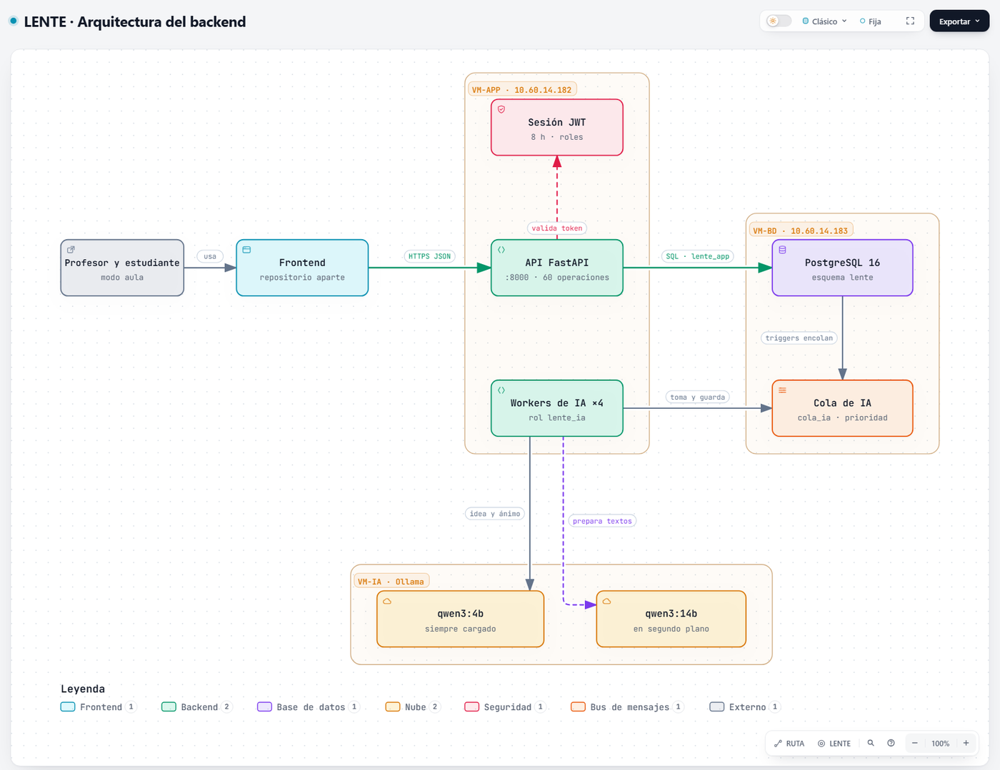

# Arquitectura



[Abrir el diagrama interactivo](arquitectura/lente-arquitectura.html): se
puede acercar, buscar componentes, seguir una ruta, cambiar a tema oscuro y
abrir el código que respalda cada caja. Se genera con
[archify](https://github.com/tt-a1i/archify) a partir de
`arquitectura/lente.architecture.json`; para regenerarlo:

```bash
node <ruta-de-archify>/bin/archify.mjs finalize architecture \
    docs/arquitectura/lente.architecture.json docs/arquitectura/lente-arquitectura.html \
    --repo-root . --quality showcase
```

Las citas de código del diagrama apuntan a la revisión fijada en
`meta.repository.revision`; al cambiar la arquitectura, actualice esa revisión
y las líneas citadas.

La mayor parte de la lógica de negocio vive en PostgreSQL (triggers,
funciones y vistas). El backend es delgado: llama funciones, lee vistas y
devuelve JSON.

## Dos procesos, dos roles de base de datos

| Proceso | Rol PostgreSQL | Responsabilidad |
|---|---|---|
| API (`app/`) | `lente_app` | Login, panel, textos, actividades, gamificación |
| Worker (`worker/`) | `lente_ia` | Cola de IA; no ve nombres de estudiantes (RNF-06) |

## Estructura del código

```
app/
  main.py          crea la aplicación y registra los routers
  core/config.py   variables de entorno (.env)
  core/db.py       pool de conexiones (lente_app)
  core/security.py tokens JWT y control de roles
  routers/         endpoints HTTP
  schemas/         modelos Pydantic de entrada y salida
  services/        consultas SQL a funciones y vistas
worker/
  ia_worker.py     bucle de la cola de IA
  modelos.py       formato fijo de las respuestas del modelo
  prompts.py       instrucciones al modelo
```

## Reglas

- Consultas siempre parametrizadas (`%s`), nunca concatenar texto del usuario.
- Aislamiento entre profesores (RNF-05): toda consulta de un profesor filtra
  por `profesor_id` del token (el esquema no tiene Row Level Security).
- Secretos solo en `.env`, nunca en el repositorio.
